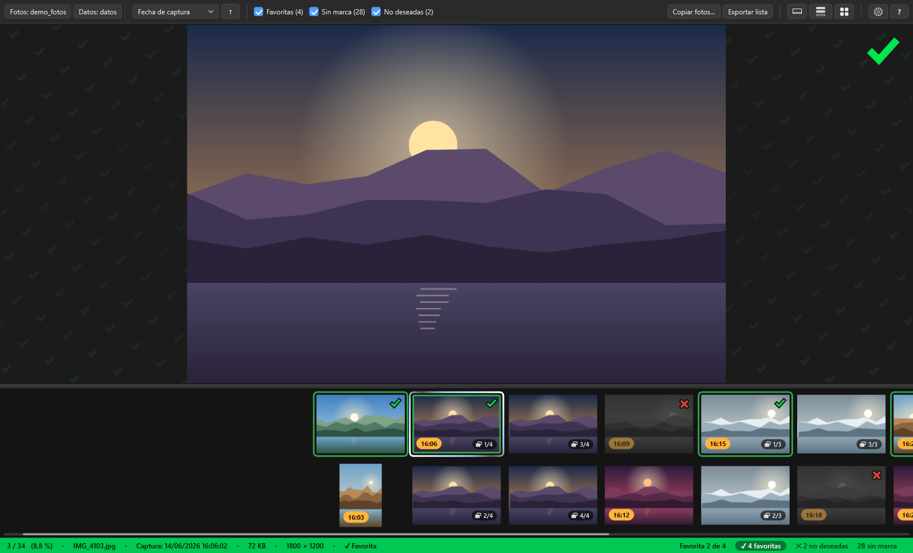
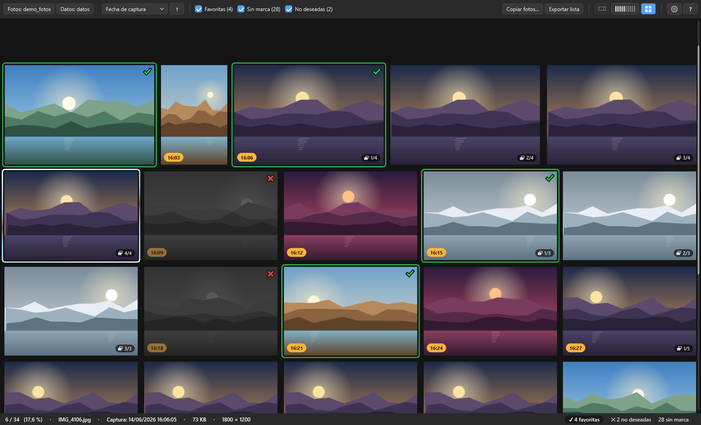
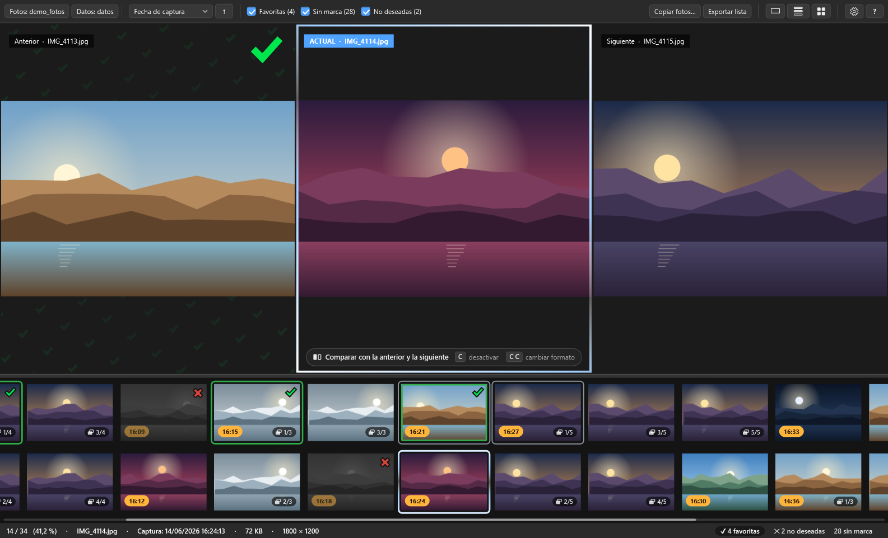
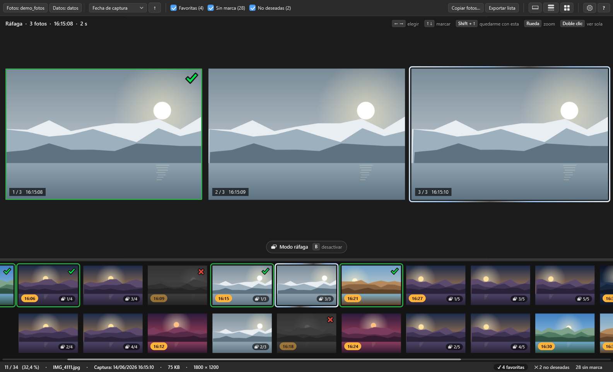

# Selector de Fotos

**Fast, portable photo culling for Windows.** Go through thousands of photos (a wedding, a trip, a photo shoot), mark favorites and rejects with the arrow keys, compare similar shots side by side, review bursts and copy your selection, all without touching the originals.

[](https://github.com/SamukSchiller/SelectorDeFotos/releases/latest)

[](LICENSE)

[Español](README.md) · [Download](https://github.com/SamukSchiller/SelectorDeFotos/releases/latest) · [Changelog](CHANGELOG.md)

> The app's interface is in Spanish. This page explains everything in English; the full Spanish manual is the [main README](README.md).



| Grid (G) | Compare (C) | Bursts (B) |
|---|---|---|
|  |  |  |

## Video tutorial

https://github.com/user-attachments/assets/3d6f5f96-426d-4dfd-879e-21b35b5bdd77

A short tutorial (1:48, in Spanish with subtitles): marking with the arrow keys, comparing, reviewing bursts and copying your selection. [Watch on GitHub](https://github.com/SamukSchiller/SelectorDeFotos/blob/main/README.en.md#video-tutorial) · [Download the original-quality video](https://github.com/SamukSchiller/SelectorDeFotos/raw/main/docs/tutorial.mp4) (MP4, 1080p, 17.4 MB).

## Features

- **Keyboard first**: ← → to move, ↑ to mark as favorite, ↓ to reject, Ctrl + Z to undo. You can also mark with the mouse, using the buttons on thumbnails and the bar at the bottom of large photos.
- **Clear feedback**: a subtle mosaic of green checks or red crosses fills the background behind a marked photo, and the mark icon animates as you mark.
- **Originals are never modified, moved or deleted.** Marks are stored separately in a data folder of your choice.
- **Compare**: the current photo next to the next one, the previous one, or both, with synchronized zoom.
- **Bursts**: shots taken within 1–3 s of each other are grouped and shown side by side. You can keep only the best one with a single key, and zoom into all of them at the same point.
- **Sharpest photo and similar shots** (optional, with the on-disk thumbnail cache): marks the sharpest frame of each burst and groups near-identical poses.
- **Thumbnail strip**: on any side, with 1 to 3 rows or columns. You can keep the current photo centered or scroll freely, Lightroom-style. A full-screen grid is also available.
- **Moments**: orange time labels show where a new moment starts (more than 30 s since the previous photo).
- **Loupe and zoom**: mouse wheel to zoom, Z or middle click to see 100 % under the cursor. Space shows only the photo, full screen.
- **Info panel**: RGB histogram with clipping warnings, plus camera, lens, aperture, shutter speed, ISO and focal length.
- **Filters**: show any mix of favorites, unmarked photos and rejects. Jump to the next favorite, unmarked photo or reject.
- **Favorites goal**: for example 80 for an album, with live progress.
- **Copy, export and import**:
  - Copy each category to its own folder, byte for byte, keeping names, dates and EXIF data.
  - Export the list of favorites (also to the clipboard).
  - Import a list of names someone sent you.
- **Favorites slideshow** with crossfade and adjustable speed.
- **Safe storage**: atomic, verified saves; daily backups; automatic recovery from a damaged file; read-only mode if a second window opens the same data, with a visible "Solo lectura" badge that also lets you retry once the other window is closed.
- **Fast with large folders**: tested with 4,400+ photos. Thumbnails load in the background, prioritizing the photos near the current one.
- Formats: JPG, PNG, BMP, GIF, TIFF, WEBP, HEIC/HEIF and AVIF. HEIC and AVIF need the free Microsoft Store extensions.

## Download and run

1. Download **`SelectorDeFotos-1.0.zip`** from [Releases](https://github.com/SamukSchiller/SelectorDeFotos/releases/latest).
2. Unzip it anywhere (a USB stick works too) and run `SelectorDeFotos.exe`.
3. The first time, Windows SmartScreen may say *"Windows protected your PC"*, because the program is not digitally signed. Click **More info → Run anyway**.

**Requirements:** Windows 10 or 11. It uses .NET Framework 4.8, which ships with Windows, so there is nothing to install. It does not touch the registry. To uninstall, delete the folder.

## Getting started

1. **Fotos…** (*Photos*): choose the folder you want to review.
2. **Datos…** (*Data*): choose where to keep your marks, copies and exported lists.
3. Review with the keyboard, then use **Copiar fotos…** (*Copy photos*) or **Exportar lista** (*Export list*).

### Main shortcuts

| Key | Action |
|---|---|
| ← / → | Previous / next photo |
| ↑ / ↓ | Favorite / reject (pressing again in the other direction removes the mark) |
| U or Backspace | Remove the mark |
| Ctrl + Z | Undo the last mark |
| F · N · X (Shift to go back) | Next favorite · unmarked · reject |
| Space | Photo-only full view |
| C · C C | Compare on/off · change compare layout (Esc also turns it off) |
| B | Burst mode on/off (Esc also turns it off) |
| Shift + ↑ (burst view) | Keep only this one (the rest of the burst becomes rejects) |
| G | Full-screen thumbnail grid |
| M | Thumbnails at the bottom / at the side |
| I | Info panel and histogram |
| Z or middle click (hold) | Loupe at 100 % |
| Wheel, + / − · 0 or Esc | Zoom · reset zoom |
| Ctrl + G | Go to a photo by name or position |
| P | Favorites slideshow |
| E · O | Show in Explorer · open with the default app |
| PgUp / PgDn | Jump 10 photos (pages in burst view) |
| Ctrl + + / Ctrl + − / Ctrl + 0 | Interface size |
| F11 · F5 | Full screen · reload the folder |
| Alt | Options menu ⚙ |
| ? | All shortcuts, grouped |

## Where your data goes

The **data folder** contains your marks (`SelectorDeFotos.marcas.json`), the copied photos (`seleccionadas`, `sin_marca`, `no_deseadas`) and the exported lists. Internal files go in its `data` subfolder: backups, the thumbnail cache and the error log. Preferences are saved next to the program, in `SelectorDeFotos.ajustes.json`.

## Build from source

No SDK needed. The C# compiler that ships with Windows (.NET Framework 4.8) is enough:

```bat
build.cmd
```

This produces `SelectorDeFotos.exe` in the project folder. `build.cmd path\to\other.exe` builds elsewhere. During development, `actualizar.ps1 -Abrir` closes the running app (saving first), builds and reopens it.

The UI is built in code (WPF, no XAML). `MainWindow` is a single partial class split by topic:

| Folder | Contents |
|---|---|
| `src/Program.cs` | Entry point |
| `src/Base` | Models and settings, image loading, load queue, Win32 interop, dark theme, assembly info |
| `src/Ventana` | Main window: viewer, zoom and loupe, compare, full view, focus ring, info panel and histogram, go to, slideshow, preferences, version and error log |
| `src/Miniaturas` | Thumbnail strip, free scrolling, grid |
| `src/Marcas` | Marks, keyboard, filters and undo; mark bar; thumbnail hover buttons |
| `src/Rafagas` | Burst detection and view; sharpness and similarity analysis |
| `src/Datos` | Folders and safe saving, copying photos, thumbnail cache, import/export |
| `src/Menus` | Options menu, context menus, menu helpers |
| `src/Dialogos` | One dialog per file |
| `src/Pruebas` | Test mode: `SelectorDeFotos.exe --autotest "keys,..." out.png` renders an off-screen window and saves a screenshot |

## License

© 2026 [SamukSchiller](https://github.com/SamukSchiller). Released under the [MIT License](LICENSE).
